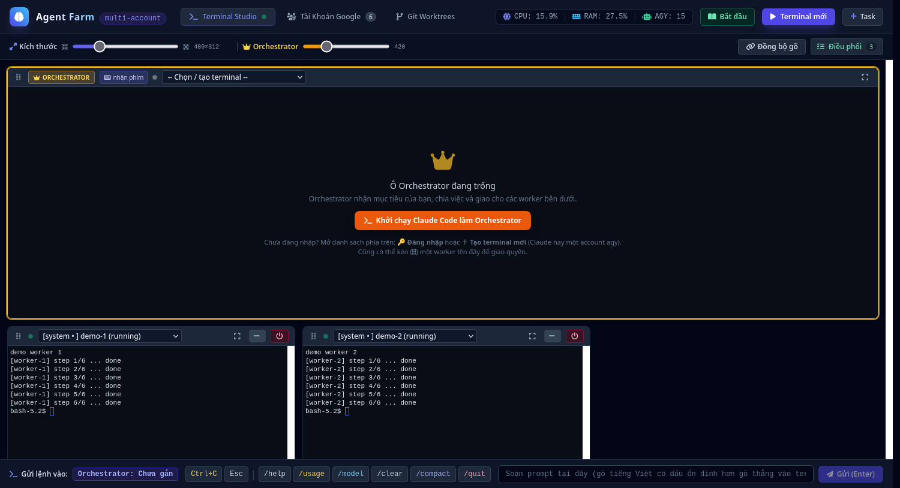

# 🚀 Agent Farm — điều phối nhiều AI coding agent trên web

> 🇬🇧 English: [README.md](README.md)



Dashboard nội bộ (`http://localhost:8888`) để chạy và điều phối **nhiều terminal agent cùng lúc** từ một trang web:

* **Nhiều tài khoản Google chạy Antigravity CLI (`agy`)**, mỗi tài khoản có token/keyring tách biệt (`~/.agy_profiles/accN/`), không bao giờ lẫn token.
* **Claude Code làm Orchestrator**: nhận mục tiêu, tự chia việc và giao cho các worker `agy` qua CLI của hub.
* Terminal thật (xterm.js) cho từng agent, **không mất khi restart hub** (tmux).

> **Hệ điều hành:** Linux. Windows chỉ dùng được qua **WSL2**; macOS chưa hỗ trợ. Xem [Yêu cầu hệ thống](#-yêu-cầu-hệ-thống).

---

## 🌟 Tính năng

1. **Terminal Studio** (trang chính)
   * Ô **Orchestrator** to nhất ở trên cùng (mặc định Claude Code, hoặc một account `agy` bất kỳ); các ô **worker** xếp bên dưới, mỗi session một ô, tự xuất hiện khi có session mới.
   * Hai thanh kéo kích thước: một cho ô worker (rộng, cao, cỡ chữ đi cùng nhau), một riêng cho Orchestrator. Trang cuộn được; lăn chuột trên terminal để cuộn nội dung terminal, hết chỗ cuộn thì trang cuộn (giữ **Alt** để luôn cuộn trang).
   * **Đồng bộ gõ**: bật rồi tick các ô muốn nhận phím, gõ ở một ô thì các ô đã tick nhận y hệt.
   * Kéo thả (⋮⋮) để đổi chỗ ô; kéo một worker lên ô Orchestrator để giao quyền Orchestrator.
   * Danh sách chọn ở mỗi ô: chọn session sẵn có, **＋ tạo terminal mới** (Claude hoặc một account `agy`, kể cả nhiều terminal cùng một account) hoặc **🔑 đăng nhập**.
   * Ngăn **Điều phối**: lập kế hoạch giao việc (mỗi worker một việc), bảng tiến độ, nhật ký lệnh và kết quả.
2. **Tài Khoản Google**: danh sách account `agy` kèm email, ghi chú vai trò (tuỳ chọn), đăng nhập/đăng nhập lại; thẻ Claude Code ở đầu trang.
3. **Git Worktrees**: tạo worktree riêng cho từng account để không sửa đè file nhau.

### Cô lập token
Mỗi account có `HOME` riêng, một D-Bus session và một `gnome-keyring` riêng (dùng chung cho mọi terminal của account đó). Biến môi trường trỏ tới kho khoá của desktop (`SSH_AUTH_SOCK`, `DBUS_*`, `XDG_RUNTIME_DIR`…) bị loại bỏ trước khi chạy `agy`. Đăng nhập lại một account chuyển dữ liệu cũ vào `~/.agy_profiles/_backup/` (không xoá).

### `agy` và Claude Code khác nhau thế nào?
| | `agy` (Antigravity CLI) | Claude Code |
|---|---|---|
| Hãng / model | Google (Gemini) | Anthropic (Claude) |
| Tài khoản | Mỗi account một Google riêng trong `~/.agy_profiles/` | Một tài khoản Claude của máy (`~/.claude`) |
| Vai trò trong hub | Worker (có thể làm Orchestrator) | Orchestrator mặc định |
| Chế độ (`--mode`) | `plan`, `accept-edits` (và `auto`) | Không dùng cờ này; có chế độ riêng (Shift+Tab) |

Một email dùng cho cả hai dịch vụ không xung đột: token và quota hoàn toàn riêng.

### Chế độ khi tạo terminal `agy`
* **Planning** → `agy --mode plan`: lên kế hoạch/spec, không tự sửa file.
* **Implementer** → `agy --mode accept-edits`: tự động sửa và lưu file.
* **Interactive** → `agy`: chạy thường, hỏi duyệt từng bước.

---

## 📂 Cấu trúc

```text
agent-farm/
├── server.py            # FastAPI + WebSocket PTY, quản lý session / tmux / runtime từng account
├── start.sh · stop.sh   # chạy / dừng hub
├── requirements.txt
├── static/index.html    # giao diện (Vue 3, Tailwind, xterm.js)
├── scripts/
│   ├── orchestrator.py  # CLI để Orchestrator giao việc / đọc kết quả
│   ├── login_profile.sh # đăng nhập OAuth cho một account
│   └── open_agy.sh      # mở agy của một account ngoài web
├── .claude/skills/agy-orchestrator/  # skill dạy Claude Code làm Orchestrator
├── CLAUDE.md
└── data/                # trạng thái cục bộ (tasks, session, nhật ký) — không đưa lên git
```

---

## ⚡ Cài đặt & chạy

### Kiểm tra môi trường
Mở web → nút **Bắt đầu** (hoặc `GET /api/doctor`): hub tự kiểm tra `agy`, `dbus-daemon`, `gnome-keyring`, `tmux`, `claude` và số account đã đăng nhập, kèm lệnh cài còn thiếu.

### Yêu cầu hệ thống
* **Linux** (Ubuntu/Debian khuyến nghị) với `python3 >= 3.10`, `bash`, `dbus-daemon`, `gnome-keyring`.
  ```bash
  sudo apt install dbus gnome-keyring tmux
  ```
* **Antigravity CLI (`agy`)** đã cài và có trong `PATH`. **Claude Code (`claude`)** nếu muốn dùng làm Orchestrator.
* `tmux` là tuỳ chọn nhưng nên có: không có thì restart hub sẽ mất terminal đang mở.
* **Windows:** hub dùng `pty`/`fcntl`/`termios`, tmux, D-Bus và gnome-keyring nên **không chạy native trên Windows**. Dùng **WSL2** (cài các gói ở trên trong WSL, mở `http://localhost:8888` bằng trình duyệt Windows). Chưa được kiểm thử trên WSL.
* **macOS:** chưa hỗ trợ (cô lập token dựa trên D-Bus/gnome-keyring của Linux).

### Cài thư viện & chạy
```bash
cd agent-farm   # thư mục repo
pip install -r requirements.txt
./start.sh            # mặc định http://127.0.0.1:8888 ; đổi cổng: ./start.sh 9000
```
Dừng: `./stop.sh` (chỉ dừng tiến trình đang lắng nghe trên cổng, không đụng tới trình duyệt). Đổi code `server.py` thì cần restart; sửa `static/index.html` chỉ cần tải lại trang.

---

## 🔁 Terminal không mất khi restart hub (tmux)

Mỗi terminal chạy trong một session **tmux** riêng (socket `agyhub`); terminal trên web chỉ là client gắn vào. Tắt hoặc restart hub (kể cả `kill -9`) chỉ làm mất client: agent vẫn chạy, hub mới tự gắn lại và trình duyệt tự nối lại không cần tải trang.

* tmux được tìm trong `PATH`; nếu không có thì dùng bản cục bộ `~/.local/share/agy-hub/tmux/bin/tmux` nếu bạn có đặt ở đó. Không có cả hai thì hub chạy như thường (restart là mất terminal).
* D-Bus và keyring của từng account (`~/.agy_profiles/accN/.run/`) được giữ sống cùng terminal; hub dọn chúng khi account không còn terminal nào.
* Siêu dữ liệu session ở `data/sessions.json`. Dừng hẳn một terminal: nút **Dừng** trên giao diện, hoặc `tmux -L agyhub kill-session -t agy-<id>`; xem danh sách: `tmux -L agyhub ls`.
* Giới hạn: đã tắt phím tắt và chuột của tmux nên cuộn lịch sử dùng scrollback của trình duyệt; mã thoát của lệnh không còn được ghi lại.

---

## 🤖 Dùng Claude Code làm Orchestrator

Mở ô Orchestrator → danh sách chọn → **＋ Claude Code**. Claude Code chạy trong thư mục `agy-hub`, đọc `CLAUDE.md` và skill `agy-orchestrator`, rồi điều phối worker bằng:

```bash
python3 scripts/orchestrator.py list                         # trạng thái các account
python3 scripts/orchestrator.py dispatch -t acc2 -p "..."    # giao việc (--session <id> để chọn đúng terminal)
python3 scripts/orchestrator.py read -t acc2 -n 40           # đọc terminal của worker
python3 scripts/orchestrator.py wait -t acc2 --timeout 120   # đợi worker xong
python3 scripts/orchestrator.py collect --id <dispatch_id>   # lưu kết quả vào nhật ký trên web
python3 scripts/orchestrator.py control -t acc2 -a interrupt # ngắt / esc / enter / terminate
```
Hub từ chối giao việc cho worker đang bận hoặc đang chờ duyệt (dùng `--force` để bỏ qua).

---

## 🛡️ Bảo mật & dữ liệu

* Token Google nằm ở `~/.agy_profiles/accN/` (ngoài repo). Token Claude ở `~/.claude`. **Không bao giờ commit hai thư mục này.**
* `data/` chứa đường dẫn, prompt và email của bạn nên đã nằm trong `.gitignore`.
* Hub là dự án cộng đồng, **không chính thức**, không liên kết với Google hay Anthropic.
* Hub chỉ nên lắng nghe `127.0.0.1`. Nó cho phép chạy lệnh tuỳ ý trên máy, nên **đừng mở cổng ra mạng** khi chưa có xác thực.

---

## 🧩 Biến môi trường
* `AGY_PROFILES_DIR` (mặc định `~/.agy_profiles`) và `AGY_DATA_DIR` (mặc định `./data`): đặt sang thư mục riêng để chạy một hub thử mà không đụng hub thật. Mỗi thư mục account chỉ cho **một** hub quản lý (khoá `.hub.lock`).
* Thư viện giao diện (Vue, xterm.js, Tailwind, Font Awesome) nằm sẵn trong `static/vendor/` nên hub chạy được khi không có internet.
